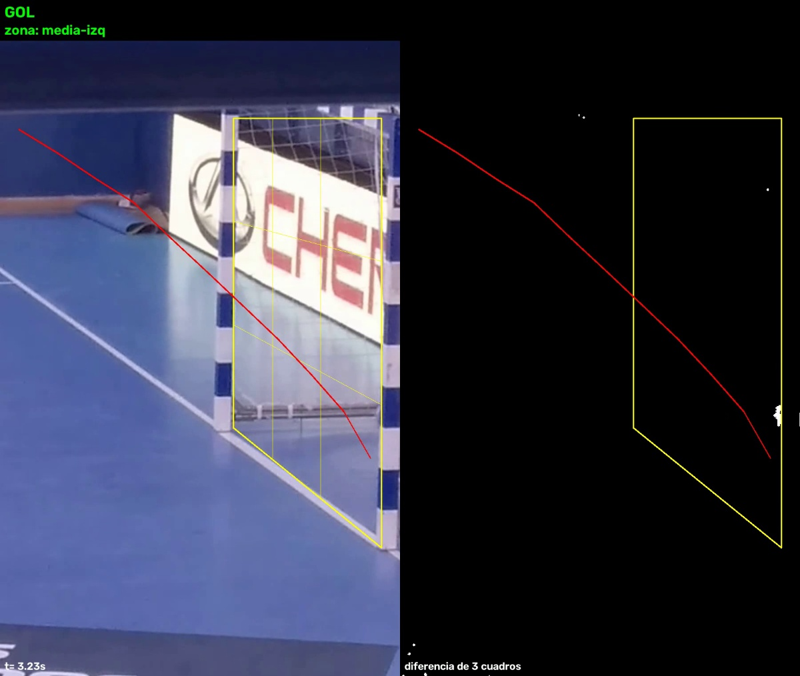

# HandStats

Análisis automático de lanzamientos al arco en balonmano a partir de video.

Proyecto del ramo **TEL-328 Procesamiento Digital de Imágenes** (UTFSM).

La idea salió de una reunión con la Federación de Balonmano de Chile: tener una herramienta que, a partir del video de una cámara apuntando al arco, detecte cada lanzamiento y diga hacia qué zona del arco fue, si terminó en gol, si el arquero atajó (y dónde) o si se fue afuera.



## Estado (entrega final)

- [x] Estabilización de video grabado con cámara en mano (ORB + homografía con RANSAC), con zona estática configurable (`--estatica`).
- [x] Arco marcado una vez por video y grilla de 3x3 zonas mediante homografía al plano del arco (300 x 200 cm).
- [x] Herramienta para elegir el cuadro de referencia y marcar las esquinas del arco con clicks (y modo revisión sin ventana).
- [x] Detección del balón por diferencia de 3 cuadros, con tamaños que se escalan según la altura del arco (sirve para video de celular comprimido y para 1080p).
- [x] Detección del balón con YOLO (`--detector yolo`), con el modelo pre-entrenado de COCO o con el modelo propio.
- [x] Seguimiento del balón con modelo de velocidad constante, desde la mano del lanzador hasta el arco.
- [x] **Clasificación del resultado: GOL, ATAJADA (con el punto donde ataja el arquero en cm y zona), POSTE y FUERA** (`src/clasificacion.py`), para cámara lateral y para cámara frontal fija.
- [x] **Fine-tuning de YOLO con un dataset propio** (clase `balon`): etiquetado semiautomático con dos "profesores" (YOLO COCO + pipeline clásico), revisión manual con mosaicos, entrenamiento y comparación contra el modelo de COCO.
- [x] Pruebas automáticas del clasificador (`tests/`).
- [ ] Estimar la velocidad del lanzamiento (trabajo futuro: requiere calibrar la profundidad, no basta con el plano del arco).
- [ ] Estadísticas de partido completo (trabajo futuro).

## Estructura

```
src/
  pipeline_balon.py   pipeline principal: estabilización, detección (clásica o YOLO), seguimiento y resultado
  clasificacion.py    clasificación del lanzamiento: GOL / ATAJADA / POSTE / FUERA, zona y punto en cm
  marcar_esquinas.py  elegir el cuadro de referencia y marcar las esquinas del arco con clicks
  demo_arco.py        versión para cámara fija frontal: YOLO o sustracción de fondo, varios lanzamientos
  crear_dataset.py    dataset propio para YOLO (etiquetado semiautomático + revisión manual)
  entrenar_yolo.py    fine-tuning de YOLO y comparación con el modelo de COCO
tests/                pruebas del clasificador
flujo_demo.ps1        comandos de la demo de la presentación final
dataset_etiquetas/    etiquetas extra (exportadas por el pipeline y hechas a mano)
docs/                 manual de uso, figuras y resultados de ejemplo
videos/               poner aquí los videos (no se suben al repo; ver docs/videos.md)
modelos/              pesos de YOLO (no se suben al repo)
salida/               resultados generados (no se suben al repo)
```

## Instalación

Requiere Python 3.10 o superior.

```bash
python -m venv .venv
source .venv/bin/activate        # en Windows: .venv\Scripts\activate
pip install -r requirements.txt
```

- `ultralytics` solo hace falta para el detector YOLO, `crear_dataset.py` y `entrenar_yolo.py`.
- `imageio-ffmpeg` (o `ffmpeg` instalado en el sistema) es opcional: si está, los videos de salida se guardan en H.264 y se reproducen en cualquier lado; si no, quedan en MPEG-4.
- Los pesos de YOLO van en `modelos/`: `yolo11n.pt` (COCO, se descarga solo la primera vez que ultralytics lo pide) y `handstats_balon.pt` (nuestro modelo, se genera con `entrenar_yolo.py`).

## Uso rápido

```bash
# 1. marcar el arco (barra para elegir el cuadro, 4 clicks en las esquinas interiores)
python src/marcar_esquinas.py videos/rusia_gol1.webm

# 2. procesar el lanzamiento
python src/pipeline_balon.py videos/rusia_gol1.webm --desde 70 --hasta 110 --ref 96 \
    --esquinas 1205,160 1405,160 1405,740 1205,578 --salida salida/rusia_gol1

# 3. ver resultados
salida/rusia_gol1/demo_zoom_lento.mp4, trayectoria_balon.png, resultado.txt
```

| Parámetro | Qué es |
|---|---|
| `--ref` | cuadro de referencia, donde se marcaron las esquinas |
| `--esquinas` | esquinas interiores del arco en ese cuadro (x,y): sup-izq sup-der inf-der inf-izq |
| `--desde`, `--hasta` | tramo del video a procesar (cuadros) |
| `--detector` | `dif` (diferencia de 3 cuadros, por defecto) o `yolo` |
| `--modelo` | pesos YOLO para `--detector yolo` (por defecto `modelos/handstats_balon.pt`) |
| `--estatica` | y máxima de la zona sin jugadores usada para estabilizar (pared, techo) |
| `--balon-px` | diámetro del balón en píxeles, si el cálculo automático no calza |
| `--fps` | forzar los fps cuando el archivo trae un valor erróneo |
| `--salida` | carpeta de resultados |

Genera en la carpeta de salida: `demo_balon.mp4` (video con arco y trayectoria + máscara), `demo_zoom_lento.mp4` (zoom en cámara lenta x4), `trayectoria_balon.png`, `trayectoria_balon.csv`, `resultado.txt` y `etiquetas_balon.csv` (para el dataset).

### Cámara fija frontal (demo_arco.py)

```bash
python src/demo_arco.py videos/sesion.mp4 --modelo modelos/handstats_balon.pt   # YOLO propio
python src/demo_arco.py videos/sesion.mp4 --metodo fondo                        # sustracción de fondo
```

Pensado para el montaje definitivo (celular en trípode detrás del lanzador). Procesa varios lanzamientos por video y genera el video anotado, un CSV con cada lanzamiento y el mapa del arco con todos los tiros, coloreados por resultado.

### Dataset propio y fine-tuning de YOLO

```bash
python src/crear_dataset.py videos/*.webm videos/*.ogg --modelo modelos/yolo11n.pt --val selestat2 --salida dataset
python src/crear_dataset.py --salida dataset --descartar 1 2 3        # ids malos vistos en dataset/revision_*.jpg
python src/crear_dataset.py --salida dataset --extra dataset_etiquetas/*.csv --val u18_but
python src/entrenar_yolo.py --datos dataset/data.yaml --base modelos/yolo11n.pt --epocas 40
```

Resultado en el conjunto de validación (videos no usados para entrenar):

| Modelo | Precisión | Recall | F1 | AP50 |
|---|---|---|---|---|
| YOLO11n COCO pre-entrenado | 0.667 | 0.087 | 0.154 | 0.26 |
| HandStats fine-tuning | 1.0 | 0.217 | 0.357 | 0.506 |

El manual de uso (`docs/manual_de_uso.pdf`) explica cada paso con capturas.

## Cómo funciona

1. **Estabilización:** puntos ORB en la parte estática de la imagen y homografía de cada cuadro al de referencia. El arco queda fijo aunque la cámara se mueva.
2. **Arco:** con las 4 esquinas se calcula la homografía imagen → plano del arco (cm), que se usa para la grilla y para convertir posiciones a centímetros.
3. **Balón:** diferencia de los cuadros t-2, t y t+2 del video estabilizado, umbral, morfología y filtro por tamaño (descartando manchas pegadas a jugadores), o detecciones de YOLO llevadas al cuadro de referencia.
4. **Seguimiento:** unión de candidatos con predicción de velocidad constante; la pista del balón es la racha más larga de pasos rápidos en la misma dirección, completada hacia atrás hasta la mano del lanzador.
5. **Resultado (`clasificacion.py`):** GOL si el balón entra y la red lo frena; ATAJADA si al llegar al arco rebota o se desvía de golpe (ese punto es donde ataja el arquero); POSTE si el rebote es pegado al marco; FUERA si pasa sin entrar.

## Limitaciones conocidas

- Grabando de lado, la fila de la zona es confiable pero la columna no: el balón se ve "cruzando" el arco antes de llegar al plano. El montaje recomendado es cámara fija y frontal.
- La homografía de estabilización supone un plano (la pared). Con cámara en mano que se desplaza, el piso queda mal alineado (paralaje) y aparecen falsos movimientos; por eso se limita la búsqueda a la altura del arco.
- Las esquinas del arco se marcan a mano una vez por video.
- La atajada se validó con trayectorias de prueba; los videos públicos que conseguimos son resúmenes de goles. Falta grabar sesiones con atajadas reales.

## Videos de prueba

Los videos usados para probar y para el dataset son de Wikimedia Commons con licencia libre (ver `docs/videos.md`).

## Equipo

- Matías Ramos
- Ignacio Cubillos
- Bruno Yáñez
